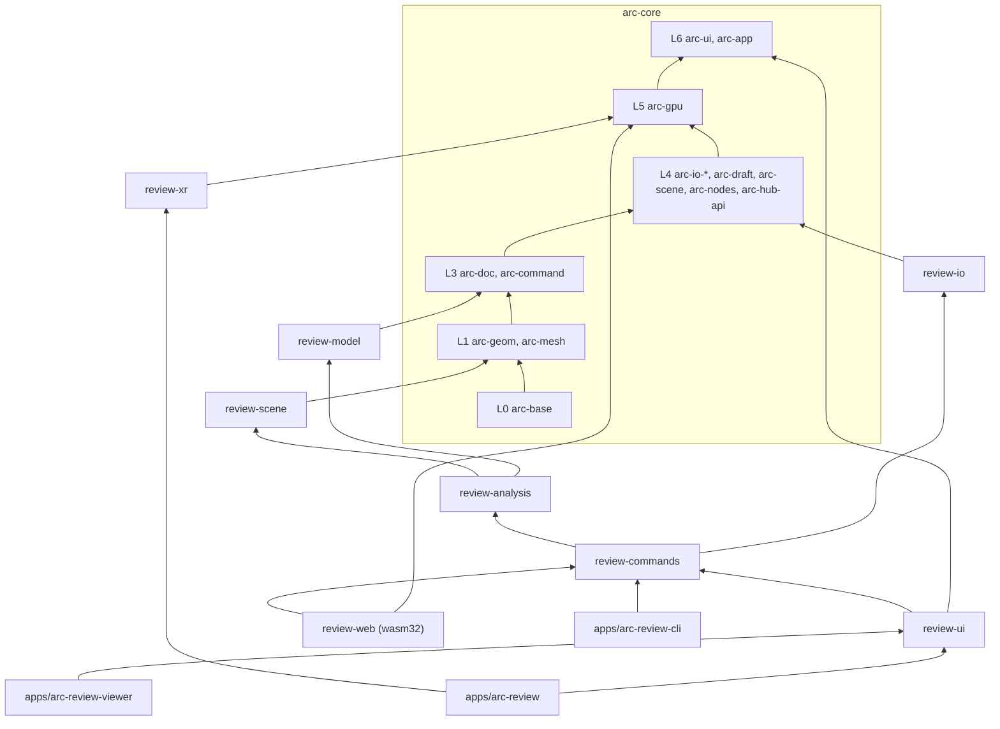

# Arc Review

Model and drawing review for buildings and infrastructure: federation, clash detection, model
checking, 4D and 5D, quantity takeoff, markup, mobile field review and immersive review.

> **Status: design phase.** No builds are available yet. This repository contains the product definition, architecture and roadmap that implementation follows.

## What it is

Arc Review reads 3D models and 2D drawings of many formats, federates them with correct units and
placement, and lets teams navigate, inspect, measure, section and mark them up; detect clashes and
check them against information requirements; manage issues in BCF; simulate construction sequences
with cost; take off quantities from models and sheets; and compare versions. It never edits source
models: all review results live in its own open document (`.arcrev`). It runs on Windows, macOS
and Linux, works offline, connects to Arc Hub for shared work, and reaches recipients through a
read-only viewer, a browser viewer, tablet and phone builds and multi-user OpenXR sessions built on
the same engine. Models from other authoring applications arrive through connectors that export
through the applications' public APIs, open readers or open formats.

## Who it is for

BIM and VDC coordinators, discipline coordinators, information managers, construction planners,
estimators, project managers, owners, and the reviewers, clients and site staff who receive review
results.

## Capability areas

| Area | Scope |
|---|---|
| [Federation](docs/product/capabilities/01-federation.md) | Open and append models, units and placement, refresh, readers, scene caches |
| [Model tree](docs/product/capabilities/02-model-tree.md) | Hierarchy, stable item keys, properties, user properties, external data links |
| [Selection and search](docs/product/capabilities/03-selection-search.md) | Picking, queries, selection sets and search sets |
| [Navigation](docs/product/capabilities/04-navigation.md) | Orbit, walk, fly, collision, gravity, avatars |
| [Appearance](docs/product/capabilities/05-appearance.md) | Hide, isolate, required items, overrides, rule-based appearance |
| [Sectioning](docs/product/capabilities/06-sectioning.md) | Section planes and box |
| [Viewpoints and animation](docs/product/capabilities/07-viewpoints-animation.md) | Viewpoints, camera paths, animation clips, interaction scripts |
| [Measurement](docs/product/capabilities/08-measurement.md) | Distances, angles, areas, clearances |
| [Markup](docs/product/capabilities/09-markup.md) | Redlines, tags, comments, attachment links |
| [Clash detection](docs/product/capabilities/10-clash-detection.md) | Tests, rules, result identity, grouping, assignment, reports |
| [Model checking](docs/product/capabilities/11-model-checking.md) | Rule sets, IDS validation, classification, bSDD, COBie |
| [Issues and BCF](docs/product/capabilities/12-issues-bcf.md) | BCF-native issues, files and API |
| [4D sequencing](docs/product/capabilities/13-sequencing.md) | Schedule import, attachment, simulation, progress, critical path, what-if scenarios |
| [5D cost](docs/product/capabilities/14-cost.md) | Cost fields, breakdowns, rates, curves, unit-rate databases, estimate versions |
| [Quantity takeoff](docs/product/capabilities/15-takeoff.md) | 3D and 2D takeoff, catalogs, change analysis |
| [Comparison](docs/product/capabilities/16-comparison.md) | Model version and sheet comparison |
| [Drawings and sheets](docs/product/capabilities/17-drawings.md) | Sheet viewing, markup, measurement, plotting, DWG version conversion |
| [Batch and publishing](docs/product/capabilities/18-batch-publishing.md) | Batch jobs, packages, images, video, print |
| [Reality data](docs/product/capabilities/19-reality-data.md) | Point clouds, reality meshes, 3D Tiles |
| [Presentation](docs/product/capabilities/20-presentation.md) | Materials, lights, rendering through RenderBuilder |
| [Immersive review](docs/product/capabilities/21-immersive-review.md) | OpenXR and multi-user sessions |
| [Read-only viewer](docs/product/capabilities/22-read-only-viewer.md) | The viewer target for recipients |
| [Browser viewer](docs/product/capabilities/23-browser-viewer.md) | The WebAssembly viewer in Arc Hub |
| [Hub integration](docs/product/capabilities/24-hub-integration.md) | Versions, issues, markups, Hub jobs |
| [Automation](docs/product/capabilities/25-automation.md) | Commands, protocol, CLI, Python, plug-ins |
| [Interoperability](docs/product/capabilities/26-interoperability.md) | Exports, review data exchange, conformance |
| [Application connectors](docs/product/capabilities/27-application-connectors.md) | Connector export from authoring applications, re-export, switch-back, licensed bridges |
| [Mobile](docs/product/capabilities/28-mobile.md) | Tablet and phone builds, field markup, offline packages, augmented reality |
| [Assistance](docs/product/capabilities/29-assistance.md) | Optional assistance checked by the clash, check, comparison and takeoff engines |

## How it fits in the suite

Arc Review depends only on [`arc-core`](https://github.com/ACKaraca/arc-core) and cooperates with
other Arc products at run time through the suite contracts:

- **Arc document package.** The review document is a document package; Arc product documents are
  opened through the products' headless exports.
- **Arc exchange package.** Connectors in authoring applications write it; Arc Review reads it and
  sends selection and view requests back to them.
- **Arc Scene.** Federations are exported to RenderBuilder for photoreal rendering and video.
- **Hub API.** Model source versions, BCF issues, markups, review jobs and the browser viewer run
  through [Arc Hub](https://github.com/ACKaraca/arc-hub).

## Architecture at a glance

Details: [architecture overview](docs/architecture/overview.md),
[delivery targets](docs/architecture/delivery-targets.md),
[large models](docs/architecture/large-models.md).

## Roadmap summary

| Milestone | Suite phase | Theme |
|---|---|---|
| M1 | 1 | Viewer: federation, navigation, sections, viewpoints, measurement, markup, sheets, read-only viewer |
| M2 | 2 | Connected review: Hub, BCF issues, browser viewer, DWG conversion and batch plotting |
| M3 | 3 | Coordination and checking: clash detection, model checking, comparison, point clouds, streaming |
| M4 | 3 | Planning and quantities: 4D, 5D, takeoff |
| M5 | 4 | Presentation through RenderBuilder, animation, video |
| M6 | 5 | Immersive multi-user review, advanced analysis, schedule logic and estimating |
| M7 | 5 | Connectors, mobile and field review |

See [roadmap](docs/roadmap.md).

## Documentation

Start at the [documentation map](docs/README.md). Product decisions are in [docs/adr](docs/adr/README.md);
automated agents follow [AGENTS.md](AGENTS.md).

## Contributing

See [CONTRIBUTING.md](CONTRIBUTING.md). Work starts from an issue; every commit carries a Developer
Certificate of Origin sign-off.

## License

Licensed under the [Apache License 2.0](LICENSE). See [NOTICE](NOTICE).

## Trademarks

Arc, ArchBuilder, DraftBuilder, CivilBuilder, SolidBuilder, MeshBuilder, RenderBuilder, Arc Review and Arc Hub are names of this project and are not covered by the Apache License; see the [trademark policy](https://github.com/ACKaraca/arc-suite/blob/main/TRADEMARKS.md). All other product and company names are trademarks of their respective owners and are used only to describe scope and interoperability.
