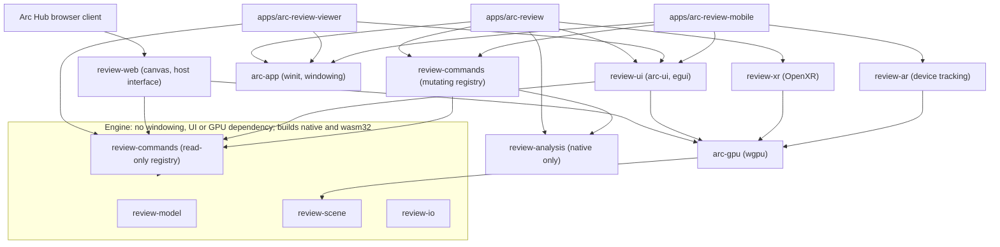

# Delivery targets

Arc Review is one engine delivered as three targets: the desktop application, the read-only viewer
and the WebAssembly viewer bundle consumed by Arc Hub. A fourth target, the tablet and phone build,
is added in phase 5. This document defines what each target contains and how the layering keeps the
engine free of windowing dependencies. The decisions are recorded in
[ADR 0002](../adr/0002-one-engine-three-delivery-targets.md) and
[ADR 0007](../adr/0007-mobile-is-a-fourth-target-of-the-same-engine.md).

## Targets at a glance

| | Desktop application | Read-only viewer | WebAssembly viewer bundle |
|---|---|---|---|
| Artifact | `arc-review` executable | `arc-review-viewer` executable | `review-web` WebAssembly module and generated bindings |
| Platforms | Windows, macOS, Linux | Windows, macOS, Linux | Browsers with WebGPU, WebGL2 fallback |
| Host | `arc-app` shell on `winit` | `arc-app` shell on `winit` | Arc Hub browser client page |
| UI | `arc-ui` panels and `review-ui` | `arc-ui` panels and `review-ui` (read-only set) | Host page UI; the bundle draws the viewport and overlays |
| Command registry | Full | Read-only subset | Read-only subset plus Hub-backed markups and issues |
| Analysis engines | Linked | Not linked | Not linked |
| Document writes | Review documents, exports | None (images and prints only) | None locally; markups and issues are written to Hub through its API |
| Source access | Files, file lists, Hub | Files, packaged documents, Hub (read) | Hub only |
| Immersive mode | Yes (phase 5) | No | No |
| Capabilities | All areas | [Read-only viewer](../product/capabilities/22-read-only-viewer.md) | [Browser viewer](../product/capabilities/23-browser-viewer.md) |

### Desktop application

Contains every capability area: federation and refresh, all review data authoring, analysis
(clash, checking, comparison, takeoff, 4D and 5D), sheets with plotting and conversion,
publishing, Hub integration, rendering through RenderBuilder, immersive review and the full
automation surface. It also offers a read-only window mode for convenience; that mode is a UI state,
not a security boundary.

### Read-only viewer

For recipients of review results. It opens linked and packaged review documents, model files and
drawings; navigates, inspects properties, finds items, measures without saving, applies session-only
visibility and sections, plays stored viewpoints, camera paths, animations and simulations, shows
markups, comments, issues and clash results read-only, prints and exports images. It honors package
restrictions (excluded items, hidden property sets, expiry and passphrase). It is a separate
executable because the commands it must not run are absent from its registry, not merely disabled,
and because it does not link `review-analysis`, which keeps it small.

### WebAssembly viewer bundle

For Arc Hub users in a browser. The bundle renders with `arc-gpu` through wgpu, streams scene cache
pages from Hub by content key, and offers navigation, model tree data, properties, visibility and
appearance, sections, measurement, viewpoints, markups, issues and sheets. It exposes a narrow,
versioned programming interface (load a federation, set camera, select by item key, apply a BCF
viewpoint, subscribe to selection and camera events) to the host page. The host page, its HTML and
JavaScript belong to Arc Hub, the single documented exception to the Rust-only rule; this
repository ships Rust compiled to WebAssembly and the bindings generated from it. No model is sent
to any external translation service: Hub converts sources with the same `review-io` readers running
headless.

### Mobile build

For site work on iOS and Android tablets and phones (phase 5). It is built from the same engine
crates, `review-ui` and `arc-app`, with touch input mapped to the same navigation and tool events.
Its registry is the read-only registry plus commands for markups, comments, issues, saved
measurements, progress records and photo attachments; it does not link `review-analysis`. It opens
packaged documents, published packages and Hub versions, keeps downloaded packages for offline use
and replays its offline queue through Hub on reconnection. The augmented-reality overlay uses the
`review-ar` crate, which keeps device camera and motion tracking behind one boundary. Capabilities:
[mobile](../product/capabilities/28-mobile.md).

## Layering

Rules that keep the engine portable:

1. Engine crates depend only on `arc-core` levels L0 to L4 and on third-party crates that build for
   `wasm32-unknown-unknown`. They never depend on `winit`, `egui`, `wgpu` or OpenXR.
2. File system, threads, time and network are reached through small traits defined in the engine
   (`SourceStore`, `CacheStore`, `TaskSpawner`, `Clock`). Native implementations live in `arc-app`
   wiring; browser implementations live in `review-web` (Hub HTTP range requests, web workers,
   performance clock).
3. Rendering is a consumer of the engine: `arc-gpu` reads cluster buffers and per-item attributes
   that `review-scene` prepares. Surface creation is the host's job (a `winit` window, a browser
   canvas, an OpenXR swapchain).
4. Input is translated into engine-level navigation and tool events by the host layer (`review-ui`
   on the desktop, `review-web` in the browser, `review-xr` in a headset), so navigation behavior is
   implemented once.
5. Mutating commands are registered in a separate registry module, and the mobile registry takes
   only the review-data subset of it; a target that does not link it
   cannot execute them through any surface (UI, protocol, plug-ins).
6. CI builds the engine crates for `wasm32-unknown-unknown` on every change and runs the
   registry test that asserts the read-only registry contains no mutating command.

## Compatibility between targets

- All targets read the same review document and scene cache formats. The viewer and the
  browser bundle of a release read documents and caches written by any earlier release and by later
  releases of the same major format.
- A capability that a target lacks degrades visibly: the viewer shows clash results but has no run
  command; the browser shows a simulation that was baked into the document as task states.
- Package restrictions are enforced by all targets alike. Because the code is open, an
  expiry date or hidden property set is a publishing convention unless the package is encrypted;
  the documents state this plainly (see [open questions](../product/open-questions.md)).
