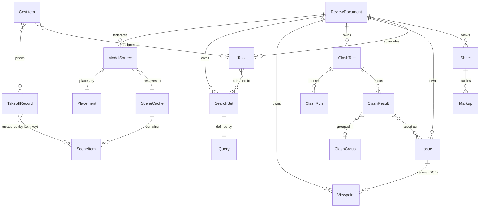

# Domain model

The object types of an Arc Review document, their key properties, relationships, invariants,
identity rules and regeneration rules. All objects below are typed objects in an `arc-doc` store
with stable 128-bit identifiers, changed only by commands inside transactions. Scene items are the
exception: they live in scene caches, are never stored in the document and are referenced by item
key.

## Two stores

| Store | Owner | Content | Lifetime |
|---|---|---|---|
| Review document (`.arcrev`) | The reviewer | Federation manifest and all review data | Authoritative; saved explicitly; journaled |
| Scene caches | Nobody (derived) | Converted model sources: items, properties, geometry, spatial hierarchy | Rebuildable at any time from the source ([ADR 0003](../adr/0003-content-addressed-scene-cache.md)) |

## Object types

### Federation

| Type | Key properties | Relationships |
|---|---|---|
| `ReviewDocument` | format version, title, metadata, mode (linked or packaged), project base point, project CRS record, display units, settings profile | Root; owns everything below |
| `ModelSource` | id, display name, reference (path, file-list entry or Hub version), format, content hash, scene cache content key, reader options, declared unit, enabled, group, load state, last refreshed | Belongs to the document; has one `Placement`; resolves to one scene cache |
| `Placement` | unit scale, translation (f64), rotation, optional survey point pair or CRS alignment | One per `ModelSource` |
| `KeyMapping` | from content key, to content key, matched pairs, method per pair (identifier, path, geometry), quality score | Produced by refresh; consumed by regeneration |
| `LossReport` | source, entries (kind, count, examples) | One per conversion of a `ModelSource` |

### Scene (in scene caches, referenced by item key)

| Type | Key properties | Relationships |
|---|---|---|
| Scene item | item key, parent, kind (source root, container, object, geometry), name, flags, bounds, geometry reference | Tree under one model source |
| Property set | name, origin (source, user, external link, computed) | Belongs to an item; user and link sets are stored in the document as overlays |
| Property | name, typed value (text, integer, real, boolean, date, quantity with unit, identifier, URI) | Belongs to a property set |

### Selection and presentation

| Type | Key properties | Relationships |
|---|---|---|
| `Query` | condition rows (property path, operator, value, unit), groups with AND/OR, scope, pick level | Embedded in sets, rules, tests, attachment rules, takeoff items |
| `SelectionSet` | name, folder, item keys | Static membership |
| `SearchSet` | name, folder, query, last evaluated revision | Dynamic membership re-evaluated on regeneration |
| `SetFolder` | name, parent, order | Tree of sets |
| `VisibilityState` | per item key: hidden, visible or required | Document-level current state; copies in viewpoints |
| `AppearanceOverride` | target (item keys or set), color, transparency, transform | Document-level current state; copies in viewpoints |
| `AppearanceRuleSet` | name, ordered rules (query or property-by-value mapping, color, transparency), unmatched policy | Applied to the scene; exported as JSON |
| `SectionState` | mode (planes or box), up to six planes, box transform, linked flag, caps | Current state; copies in viewpoints |
| `UserProperty` | item key, property set, name, typed value | Overlay on scene items |
| `ExternalLink` | data source (file or connection), table, key column, item property to match, column types | Produces a read-only property set overlay |

### Review data

| Type | Key properties | Relationships |
|---|---|---|
| `Viewpoint` | name, folder, camera (position, direction, up, projection, field of view or scale), state bundle flags, thumbnail | May own copies of visibility, overrides, section, markups, measurements |
| `CameraPath` | keyframes (camera, time), interpolation, duration | References viewpoints or stores cameras |
| `AnimationClip` | tracks (item set, transform, color, transparency keys), duration, loop mode | Bound to sets; referenced by tasks and clash tests |
| `InteractionScript` | events, conditions, actions, enabled | References clips, viewpoints, hotspots |
| `Measurement` | kind, points (f64), result quantity | Optional; owned by a viewpoint when saved |
| `Markup` | geometry (redline shapes), style, author, owner (viewpoint or sheet) | Owned by a viewpoint or a sheet |
| `Tag` | number, anchor point, leader, comment thread | Owned by a viewpoint |
| `CommentThread` | comments (author, time, text), status | Attached to viewpoint, tag, markup, set, clash result or group, finding, task |
| `AttachmentLink` | target kind (URL, file, viewpoint, issue), label, anchor item key | Shown as an icon at the item |

### Analysis

| Type | Key properties | Relationships |
|---|---|---|
| `ClashTest` | name, side A and side B (query, set or saved selection), self-test, geometry kinds per side, type (hard, hard conservative, clearance, duplicate), tolerance, hidden-item policy, linked simulation | Owns rules, runs, results, groups |
| `ClashRule` | template or custom query, enabled | Belongs to a test or a shared rule library |
| `ClashRun` | time, content key of every involved source, settings digest, counts | Belongs to a test |
| `ClashResult` | item key A, item key B, contact point, distance, grid and level location, status, assignee, approver, first and last found run, match method, viewpoint | Belongs to a test; may belong to a group; may reference issues |
| `ClashGroup` | name, status, assignee, members, origin (manual, automatic criterion) | Belongs to a test |
| `CheckRuleSet` | name, rules, parameters, origin (library, IDS, custom) | Owns runs and findings |
| `InformationRequirement` | IDS specification: applicability, requirements, cardinality | Compiled to check rules |
| `ClassificationSystem` | name, edition, entries, dictionary URIs | Used by mappings and checks |
| `CheckFinding` | rule, item keys, severity, message, status, first and last found run | Belongs to a rule set; may reference issues |
| `Issue` | BCF topic: guid, title, type, status, priority, assignee, labels, due date, comments, viewpoints, related topics, references to results and findings, extensions | Synchronized with Hub through the BCF API ([ADR 0005](../adr/0005-bcf-native-issue-model.md)) |
| `ComparisonRun` | base and target (sources, versions or sheets), match settings, time | Owns difference records |
| `DifferenceRecord` | item key or region, kind (added, removed, changed geometry, changed properties, moved), details | Belongs to a run |

### Planning and quantities

| Type | Key properties | Relationships |
|---|---|---|
| `ScheduleSource` | reference, format, field mapping, last synchronized | Produces tasks |
| `Task` | name, parent, planned start and end, actual start and end, type, progress, cost fields, local overrides | Attached to sets or attachment rules; may reference an animation clip |
| `TaskType` | name, appearance at start, during, end, early and late | Used by tasks |
| `AttachmentRule` | task field, query template, match mode | Links tasks to items |
| `Simulation` | mode (planned, actual, planned versus actual), interval, range, overlay, camera | Reads tasks; produces item states per time |
| `TakeoffCatalog` | items (code, name, unit, formulas), resources (unit, rate) | Shared or per document |
| `TakeoffRecord` | catalog item, origin (3D item keys, 2D sheet geometry, virtual), measured quantities, formula results, change state | Belongs to a workbook |
| `CostItem` | code, breakdown position, quantity, rate, amount, currency | References takeoff records and tasks |

### Sheets and output

| Type | Key properties | Relationships |
|---|---|---|
| `DrawingSource` | reference, format, content hash | Produces sheets |
| `Sheet` | layout or page, paper size, scale, layers, named views, calibration, alignment to the model | Owns markups; may be linked to viewpoints |
| `SheetSet` | ordered sheets, numbering | References sheets of several drawing sources |
| `PlotConfiguration` | device or PDF, paper, scale, plot style table, stamp | Used by print and batch plot |
| `ConversionSetup` | target version, output rules, audit, reference handling, log | Used by DWG and DXF conversion |
| `PublishProfile` | contents, metadata, start viewpoint, restrictions | Produces a packaged review document |

## Identity rules

1. Document objects have stable 128-bit identifiers that never change and are never reused.
2. A **model source identifier** is stable for the life of the document; replacing a source's file
   keeps its identifier so all review data stays attached.
3. An **item key** is (model source identifier, source element identifier). Source element
   identifiers by format: IFC GlobalId; DWG and DXF handle; STEP product path and instance
   identifiers; glTF node path; OpenUSD prim path; point cloud source plus scan identifier.
4. When a source provides no identifier, a **derived key** is computed from the item's path of
   names and its geometry hash; derived keys are flagged, and the source's key quality (share of
   items with source identifiers, duplicates found) is shown in source information.
5. Review data references scene content only by item key, never by cache row index.
6. Issues carry IFC GlobalIds or source element identifiers in their BCF components, never only
   item keys.
7. A clash result's identity is its test plus the unordered item key pair; a check finding's is its
   rule plus its item keys ([ADR 0004](../adr/0004-clash-identity-and-open-result-format.md)).

## Invariants

- No command writes to a model source; exports always create new files.
- Every item key held by review data either resolves in the current federation or is listed as
  unresolved; unresolved references are never deleted automatically.
- A search set's membership equals its query evaluated on the latest federation revision once
  regeneration has finished; consumers read membership only through the regeneration result.
- A placement is a rigid transform with positive uniform scale; non-uniform scale is rejected.
- A section state has at most six planes or exactly one box.
- A clash result belongs to exactly one test and at most one group; a group contains results of its
  own test only.
- Every clash run and check run records the content key of each involved source.
- A task's planned end is not before its planned start; actual dates may be empty.
- A packaged document embeds a scene cache for every enabled source; a linked document embeds none.
- The read-only targets hold documents open without a write handle.

## Regeneration and dependency rules

Derived state is computed by the `arc-doc` regeneration graph on worker threads, each result tagged
with the federation revision it was computed from.

| When this changes | These recompute | Mode |
|---|---|---|
| Model source refreshed (new content key) | Scene cache load; key mapping; tree; search set membership; appearance rules; visibility and overrides by key; unresolved-reference list | Automatic |
| Model source refreshed | Clash tests and check rule sets involving it are marked stale; takeoff records on its items get change states; task attachments re-evaluated; comparison against the previous version offered | Stale marking automatic; runs on demand or by automatic-run policy |
| Placement changed | Federation bounds and spatial hierarchy transforms; measurements are not changed retroactively; clash tests involving the source marked stale | Automatic |
| Query of a search set edited | That set's membership; every consumer of the set (rules, tests, attachments, takeoff items) | Automatic for membership and appearance; stale marking for analysis |
| Appearance rule set edited or reordered | Per-item appearance attributes | Automatic |
| User property or external link changed | Property overlays; dependent search sets and rules | Automatic |
| Clash rule or test settings changed | Test marked stale | On demand |
| Clash run completed | Results matched to existing identities; groups re-evaluated for automatic grouping; dashboards | Automatic after run |
| Task dates, types or attachments changed | Simulation states; cost curve | Automatic |
| Schedule source synchronized | Tasks updated per field mapping, preserving local overrides marked as kept | On demand |
| Takeoff catalog formula or rate changed | All records using it; cost items | Automatic |
| Sheet calibration changed | 2D takeoff records and sheet measurements on that sheet | Automatic |
| Viewpoint restored | Current visibility, overrides and section replaced by the viewpoint's copies where stored | Command |

Analysis results are never recomputed silently in the middle of a review: a stale test keeps its
results visible with a stale marker until the user or an automatic-run policy runs it.
