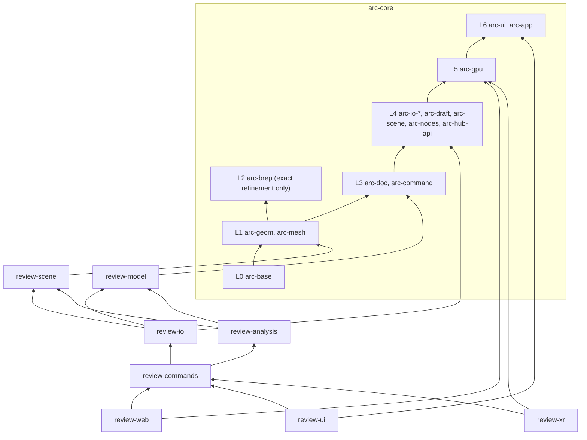
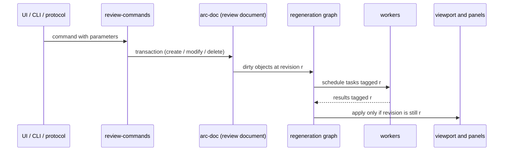

# Architecture overview

How Arc Review is built on `arc-core`: its crates, runtime flows, background work, performance
targets, automation surface and testing strategy. Suite-wide architecture is defined in
[`arc-suite`](https://github.com/ACKaraca/arc-suite/tree/main/docs/adr) and is not repeated here.

## Crates of this repository

The repository follows the suite product template and adds crates, each for a second
concrete boundary named below.

| Crate | Level | Responsibility | Builds for |
|---|---|---|---|
| `review-model` | L3 | Review document schema on `arc-doc`: federation, model sources, placements, sets, queries, appearance rules, viewpoints, markups, comments, issues, clash tests and results, check rule sets and findings, tasks, cost and takeoff records, comparison runs. Query engine and rule evaluation. Regeneration rules between review objects. | native, wasm32 |
| `review-scene` | L4 | Scene representation for large federations: scene cache format, item table, property store, geometry clusters and level-of-detail chains, spatial hierarchy, page residency and streaming policy, memory budgets. No GPU dependency. See [large models](large-models.md). | native, wasm32 |
| `review-analysis` | L4 | Compute engines: clash detection, rule-based model checking and IDS validation, model and drawing comparison, quantity takeoff evaluation, 4D simulation state, schedule logic and critical path. Excluded from the read-only viewer and the browser bundle, which is its reason to exist as a crate. | native |
| `review-io` | L4 | Mapping between `arc-io-*` neutral models and scene caches or review data: IFC, DWG/DXF, STEP, mesh formats (including FBX), 3DM, DGN V7, JT, OpenUSD, point clouds, PDF sheets, Arc exchange packages and scene caches from connectors, BCF, IDS, schedules (MSPDI, P6), unit-rate databases, tabular and report writers, documented JSON review-data formats. | native, wasm32 (read paths) |
| `review-commands` | L4 | User-level commands over the model, split into read-only and mutating registries. | native, wasm32 (read-only part) |
| `review-ui` | L6 | Panels, tools and viewport interaction on `arc-ui`: model tree, property inspector, sets, results tables, task table, workbook, sheet browser, markup and measure tools. | native |
| `review-web` | L5 | WebAssembly facade consumed by Arc Hub's browser client: canvas surface, input mapping, a versioned programming interface, Hub API streaming. No windowing or UI toolkit. | wasm32 |
| `review-xr` | L6 | OpenXR session, stereo rendering through `arc-gpu`, controller interaction and the live review session protocol. Created in phase 5. | native |
| `review-ar` | L6 | Augmented-reality overlay on tablets and phones: device camera and motion tracking, alignment to the site, capture of overlay images. Created in phase 5. | native (iOS, Android) |

| Application | Contents |
|---|---|
| `apps/arc-review` | Desktop application: all registries, all panels, analysis engines. |
| `apps/arc-review-viewer` | Read-only viewer: read-only registry, no `review-analysis`. |
| `apps/arc-review-cli` | Headless CLI: convert, validate, check, run clash tests, compare, publish, batch, serve the automation protocol. |
| `apps/arc-review-mobile` | Tablet and phone build (phase 5): read-only registry plus review-data commands, no `review-analysis`. |

The delivery targets and how layering keeps the engine free of windowing are described in
[delivery targets](delivery-targets.md).

## Use of `arc-core`

| Crate | Used for |
|---|---|
| `arc-base` | Item and object identifiers, units and quantities for properties, measurements and takeoff, tolerances for clash and comparison, colors. |
| `arc-geom` | Spatial indexes, triangle and segment intersection, distance queries, 2D regions for sheet takeoff and section outlines, TIN for terrain context. |
| `arc-mesh` | Mesh structures in scene caches, simplification for level-of-detail chains, mesh Booleans for section caps. |
| `arc-brep` | Optional exact refinement of clash contacts between B-rep sources (RV-CLASH-014); not linked by the viewer targets. |
| `arc-solve` | Unit-aware expression engine for takeoff formulas, cost formulas and computed properties. |
| `arc-doc` | Review document store, transactions, operation journal, regeneration graph, package and recovery. |
| `arc-command` | Command registry, parameter schemas, prompt machines, automation protocol, headless runner, MCP endpoint. |
| `arc-draft` | Sheet entities, layers, layouts, plot styles and plotting for drawings and sheet sets. |
| `arc-view` | Section outlines of the federation as drafting geometry (RV-SECT-016). |
| `arc-scene` | Arc Scene export to RenderBuilder and other Arc products. |
| `arc-nodes` | Node graphs for automation rules and computed checks (phase 4). |
| `arc-io-*` | `ifc`, `dxf`, `dwg`, `step`, `mesh`, `usd`, `pointcloud`, `geo`, `pdf`, `bcf`. |
| `arc-hub-api` | Hub authentication, projects, file versions, issues (BCF API), reviews and jobs. |
| `arc-gpu` | Viewport rendering, camera-relative precision, picking, section planes, shading modes, point clouds, overlays, GPU-driven culling and indirect drawing. |
| `arc-ui`, `arc-app` | Workspace, virtualized trees and tables, property grid, command line, settings, localization, plug-in loading. |

Arc Review is expected to be the first user of large-scene features in `arc-gpu` (cluster culling,
level-of-detail streaming). Those features are contributed to `arc-gpu`; the residency policy stays
in `review-scene`.

## Runtime flows

### Command, transaction, regeneration, views

Every change to a review document is a command executed in a transaction on `arc-doc`. The
transaction journal drives undo, autosave recovery and Hub synchronization. The regeneration graph
then recomputes derived review state, and views redraw from the new revision.

### Opening and refreshing sources

1. A model source is resolved (path, file list entry or Hub version) and hashed.
2. The content key is looked up in the cache directory, the packaged document or the Hub store.
3. On a miss, `review-io` runs the reader in a worker; the scene cache is written page by page and
   becomes visible progressively.
4. On refresh, a changed hash produces a new cache; item keys are matched against the previous
   cache; the refresh report lists added, removed, changed and re-keyed items.
5. Dependent review state is marked stale through the graph: search sets, appearance rules, clash
   tests, check rule sets, takeoff records, attachments of tasks and comparison runs.

### Analysis runs

Clash tests, check rule sets, comparisons and takeoff evaluations are long-running jobs. A run
snapshots its inputs (content keys, rules, settings), executes on the worker pool with progress and
cancellation, and commits its results in one transaction. A run started on revision r whose inputs
changed before completion still commits, but its results are labelled with the input revisions they
were computed from, so the user sees that the run is behind the current federation.

### Rendering

`arc-gpu` draws from GPU-resident cluster buffers that `review-scene` keeps filled within budget.
Visibility state, appearance overrides and section state are per-item GPU attributes, so hiding,
coloring and sectioning millions of items costs a buffer update, not a rebuild.

## Product-specific subsystems

| Subsystem | Crate | Notes |
|---|---|---|
| Query engine | `review-model` | One query language for search sets, appearance rules, clash rules, check rules, attachment rules and takeoff. Evaluates over columnar property stores; indexes per property on demand. |
| Item key mapping | `review-io` | Matches items across cache versions by source identifiers, then by path and geometry signature, with a quality score per source. |
| Clash engine | `review-analysis` | Broad phase over the federation spatial hierarchy, narrow phase on triangle clusters, clearance by distance queries, duplicate detection by geometry hashes; incremental re-run limited to changed items. |
| Check engine | `review-analysis` | Rule evaluation over properties, relationships and geometry; IDS facets mapped to queries. |
| Comparison engine | `review-analysis` | Item matching by key; property diff; geometry diff by hashes and Hausdorff-bounded distance; sheet overlay by raster and vector difference. |
| Simulation | `review-analysis` | Task state per date from planned and actual dates; produces visibility and appearance per item for a time value. |
| Sheet engine | `arc-draft` via `review-io` | Drawings and PDF pages as sheets; calibration, sheet-to-model alignment, plotting and DWG version conversion. |
| Schedule logic | `review-analysis` | Forward and backward pass over task links, calendars and constraints for float and critical path; what-if edits are recalculated in a scenario and never written to the linked source. |
| Connector link | `review-io`, `review-commands` | Reads exchange packages and scene caches written by connectors, applies incremental exports, and sends selection and view requests to a connector over a local authenticated endpoint ([ADR 0008](../adr/0008-switch-back-requests-carry-identifiers-only.md)). Connectors themselves live in the `arc-connectors` repository. |
| Cost databases | `review-model` | Unit-rate databases and estimate versions evaluated with the `arc-solve` expression engine; versions are frozen copies. |
| Session protocol | `review-xr` | Review state synchronization (ADR 0006); used by headset and desktop participants. |

## Threading and background work

- The UI thread handles input and panels and never blocks on I/O or analysis.
- The render thread submits GPU work; on WebAssembly rendering runs on the main thread through
  the browser's animation frame.
- A work-stealing pool runs conversion, regeneration tasks and analysis. Every task is
  cancellable and carries the revision it was started from; a stale result is never applied
  (suite ADR on revision-tagged background work).
- A residency task streams cache pages from disk or Hub in priority order (see
  [large models](large-models.md)).
- Readers for formats behind an out-of-process bridge, including a conversion library the user has
  licensed, run in a child process with memory and time limits; a crash of the bridge fails that
  source only.
- On WebAssembly, the worker pool uses web workers when cross-origin isolation is available and
  falls back to a single thread with time slicing otherwise.

## Performance targets

Targets are acceptance criteria, measured on reference hardware defined in the suite engineering
standards, with synthetic corpus models generated for the purpose.

| Target | Value | Rationale |
|---|---|---|
| First frame after opening a document with warm caches | under 2 s, independent of model size | Progressive streaming makes opening cost proportional to the visible set, not the federation. |
| Navigation frame rate (desktop) | 60 frames per second target, never below 30 during motion | Below 30 orbit and walk lose precision; the frame governor trades detail for rate. |
| Frame rate in immersive mode | runtime refresh rate (72 to 90 Hz), with reprojection never sustained | Dropped frames in a headset cause discomfort. |
| Pick and highlight | under 50 ms | Selection must feel immediate; picking uses GPU identifier buffers. |
| Property display for a selected item | under 100 ms | Property stores are paged and indexed by item. |
| Query over one million items | under 1 s for indexed properties | Search sets and rules are re-evaluated on every refresh. |
| Hide, isolate, color over one million items | under 100 ms | Per-item GPU attributes avoid rebuilds. |
| Incremental clash re-run after one source changed | proportional to changed items, not federation size | Coordination cycles re-run tests many times a day. |
| Conversion throughput | uses all cores; never blocks interaction | Large IFC and STEP sources dominate first-open time. |

## Automation surface

| Surface | Description |
|---|---|
| Commands | Every action is a registered command with a parameter schema; the read-only registry is a strict subset. |
| Command line and palette | Keyboard-first access to every command in the desktop application. |
| Arc Automation Protocol | JSON-RPC over stdio or a local socket, exposing commands, queries, the model tree, properties, selection and review data. |
| MCP endpoint | Derived from the same registry for assistant clients (phase 5). |
| Headless CLI | `arc-review-cli` runs conversions, checks, clash tests, comparisons, publishing and batch jobs with documented exit codes and JSON output. |
| Python client | Official out-of-process client of the protocol. |
| Node graphs | Automation rules and computed checks on `arc-nodes` (phase 4). |
| Plug-ins | Sandboxed WebAssembly plug-ins with a manifest and host-assigned trust: panels, tools, readers, schedule and cost sources. |

Capabilities: [automation](../product/capabilities/25-automation.md).

## Testing strategy

- **Reader corpus tests.** Each reader runs against corpus files with expected item counts, item
  keys, property values and bounding boxes; regressions fail CI. Corpus files carry owner, license
  and checksum rows.
- **Fuzzing.** Every reader, the BCF and IDS parsers, the schedule importers and the scene cache
  decoder are fuzzed with bounded recursion and allocation.
- **Golden analysis results.** Synthetic federations with known clashes, findings, quantities and
  differences assert exact result sets, identities across re-runs and status transitions.
- **Conformance suites.** BCF schemas, the published IDS test cases, glTF validation and IFC output
  validation by an independent reader.
- **Image comparison.** Viewport rendering of reference scenes compared against stored images with
  tolerances, on native and WebAssembly targets.
- **Registry tests.** The viewer and browser registries contain no mutating command; every command
  runs headless without opening a dialog.
- **Performance gates.** The targets above run on generated large federations in a scheduled job;
  a regression beyond a set margin fails the job.
- **Layering gate.** `cargo xtask layers` plus a `wasm32-unknown-unknown` build of the engine
  crates.
